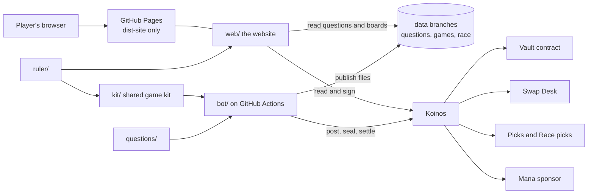
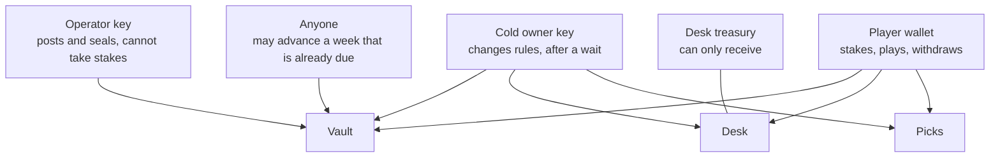

# How Knode Games is built

This is the map of the rebuild. The live contracts are unchanged. The folders around them are new.

## The money

Only three contracts hold tokens.

| Contract | Address | What it holds |
|---|---|---|
| Vault | `1Mpmf2ERhjYpX7CCiM11WERuM4j17uT1sr` | Player stakes and the weekly pots. It is also the Knode Games Pool block producer. |
| Swap Desk | `1FKTpXBhhHEbu5vVchM8UsVbAvPArJsRmR` | KOIN it pays out, and VHP it keeps producing. |
| Mana sponsor | `1ByDDSBUzy5zkRceELc54Jh8i41yNRoKt8` | KOIN it spends so players do not pay Mana. |

Picks (`1LmgqBGctL9F2YkyjTXgieTXwnYHh8Y6Pm`) and Race (`1EN7xU8R9tQXjHvrX79qZvvvGkkKWVnB5K`) store picks. They do not hold the pot. The vault pays.

The source of each contract is in `contracts/<name>/`. A move of the files does not change the bytes of a build. Do not edit those sources unless a separate, reviewed upgrade is intended. An upgrade of a live contract is announced on chain and waits. This repository does not upload anything.

## Who may do what

The sponsor is different: its own key changes its settings, with no wait. That key must stay offline except when you mean to change it.

The desk already has a treasury field that is separate from the owner. On chain today they may still be the same wallet. A new deploy from this code refuses to use the owner as the treasury. Changing the live desk is `npm run desk -- treasury schedule <address>`, then `treasury apply` after 48 hours. Do not run that until [KEYS.md](KEYS.md) says the new wallet exists.

## The website

`web/` is a static site. Pages read the chain and the published files. They do not hold a server. `tools/ci/assemble-site.mjs` copies `web/` plus the contract ABIs the pages request into `dist-site/`. GitHub Pages, when you turn it on, publishes `dist-site/` and nothing else. Tests, the bot, the admin page, and testnet pages are not in that folder.

`web/early-view.js` runs before the home page is painted so the wrong tab does not flash. `web/data-source.js` sends question-file reads to the data branch. See [DATA.md](DATA.md).

`web/fairness.html` is the public note about running block producers and games about those producers.

## Games

Daily Questions are scored from block history in `questions/`. The other games are recorded by `bot/games/` and `bot/race.ts`, and Fantasy already uses `kit/`. The page math (`web/*-math.js`) is what the browser and the recorder both have to agree with.

New games should be a folder under `games/<slug>/` with a `game.json`, a `math.js`, a `recorder.ts`, and tests, and should be rendered by `npm run kit:render`. The two games that come next are described in [NEXT-GAMES.md](NEXT-GAMES.md). They are not built yet.

## What runs where

| Piece | Where it runs | Starts by itself? |
|---|---|---|
| Website | GitHub Pages, only `dist-site/` | No. Variable `KG_ENABLE_PAGES` must be `true`, and you press Run. |
| Bot and recorders | GitHub Actions | No. Each workflow is manual, and the bot also needs `BOT_ENABLED=true`. |
| Nodes and heal tasks | The owner's PC, `ops/node/` | Only if you install the scheduled tasks on that PC. |
| Admin page | `ops/admin/`, bound to this computer | Only when you start it. |

The old workflows are still in `.github/workflows/` so the jobs can be turned back on one at a time. They have no `schedule:` and they do not run on a pull request. CI is the only workflow that runs on a pull request. See [WORKFLOWS.md](WORKFLOWS.md).
